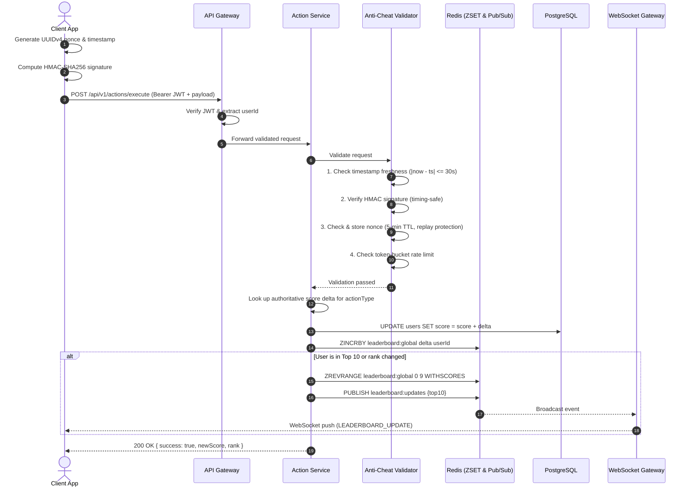

# Problem 6: Real-Time Scoreboard Module

Architecture specification for a backend API module that manages user scores, serves an authoritative top-10 leaderboard, broadcasts live updates via WebSockets, and enforces defense-in-depth security against unauthorized score tampering.

---

## 1. Execution Flow Diagram

The diagram below illustrates the end-to-end lifecycle when a user completes an action, dispatches an API request, undergoes security validation, updates persistence stores, and broadcasts live score updates:



---

## 2. Key Architecture Decisions & Anti-Cheat Controls

To prevent malicious users from inflating scores without authorization, the module enforces layered controls:

1. **Server-Authoritative Score Deltas:**
   The client **never** specifies the score increment or total score. The client only sends the `actionType` (e.g. `task_complete`), and the server looks up the immutable score delta.
2. **User Authentication:**
   Requests must provide a valid Bearer JWT. Anonymous requests are rejected immediately ($401$).
3. **HMAC-SHA256 Request Signing:**
   Payloads (`userId:actionType:nonce:timestamp`) are signed with a per-user secret derived from a master server key. Verified using `crypto.timingSafeEqual` to avoid timing attacks.
4. **Replay Protection (Nonce Store):**
   Each request requires a unique UUIDv4 nonce, stored with a 5-minute TTL. Duplicate nonces return `400 Replay detected`.
5. **Timestamp Window:**
   Requests with $|T_{\text{server}} - T_{\text{client}}| > 30\text{s}$ are rejected to prevent delayed packet replays.
6. **Token Bucket Rate Limiting:**
   Limits rapid-fire bot requests per user (burst of 10, refills 1 token every 6 seconds).
7. **Efficient Ranking (Sorted Set):**
   Maintains scores using a Sorted Set ($O(\log N)$ update, $O(K)$ top-10 retrieval). In production, this maps directly to Redis `ZSET`.
8. **Live WebSocket Broadcasts:**
   Clients connect to `ws://<host>/ws/leaderboard`. When a score change alters the top 10 standings, the server pushes the new top 10 list to connected clients.

---

## 3. API Specification

### Execute Action
Dispatches a completed action to update the user's score.

```bash
curl -X POST http://localhost:3000/api/v1/actions/execute \
  -H "Authorization: Bearer <JWT_TOKEN>" \
  -H "Content-Type: application/json" \
  -d '{
    "actionType": "task_complete",
    "nonce": "c9bf9e57-1685-4c89-bafb-ff5af830be8a",
    "timestamp": 1700000000000,
    "signature": "<HMAC-SHA256>"
  }'
```

**Response (200 OK):**
```json
{
  "success": true,
  "newScore": 1250,
  "rank": 3
}
```

### Get Top Leaderboard
```bash
curl "http://localhost:3000/api/v1/leaderboard/top?k=10"
```

**Response (200 OK):**
```json
{
  "data": [
    { "rank": 1, "member": "user-uuid-1", "score": 9850 },
    { "rank": 2, "member": "user-uuid-2", "score": 8720 }
  ]
}
```

### WebSocket Broadcast Format
Clients connect to `ws://localhost:3000/ws/leaderboard`. Broadcast message dispatched on top-10 change:
```json
{
  "type": "LEADERBOARD_UPDATE",
  "data": [
    { "rank": 1, "member": "user-uuid-1", "score": 9850 },
    { "rank": 2, "member": "user-uuid-2", "score": 8720 }
  ]
}
```

---

## 4. Suggested Improvements (Next Iteration)

1. **Protocol Buffers / MessagePack over WebSockets:** Replace JSON with binary serialization to reduce broadcast bandwidth by 40–60% during high concurrency.
2. **Delta Updates:** Broadcast diff patches (e.g. `{ userId, newScore, rank }`) rather than full 10-item arrays when only one position changes.
3. **Periodic Leaderboard Snapshots:** Snapshot historical top rankings (daily/weekly) into cold storage for season archives.
4. **Regional Sharding:** Partition leaderboards by region or tier (`leaderboard:eu`, `leaderboard:apac`) to scale beyond a single Redis instance.
5. **Circuit Breaker:** Add fallback to database read-replicas if Redis experiences transient connectivity drops.

---

## 5. Reference Implementation

A working reference implementation of this architecture is included in this directory:
- `src/anti-cheat/`: Signature verification, nonce store, and rate limiter
- `src/data-structures/`: In-memory sorted set implementation
- `src/services/`: Action service, leaderboard service, and WebSocket push service

```bash
npm install
npm test      # Runs 22 unit & integration tests
npm run demo  # Live walkthrough testing REST, WebSockets, and attack rejection
npm run dev   # Start server on :3000
```
